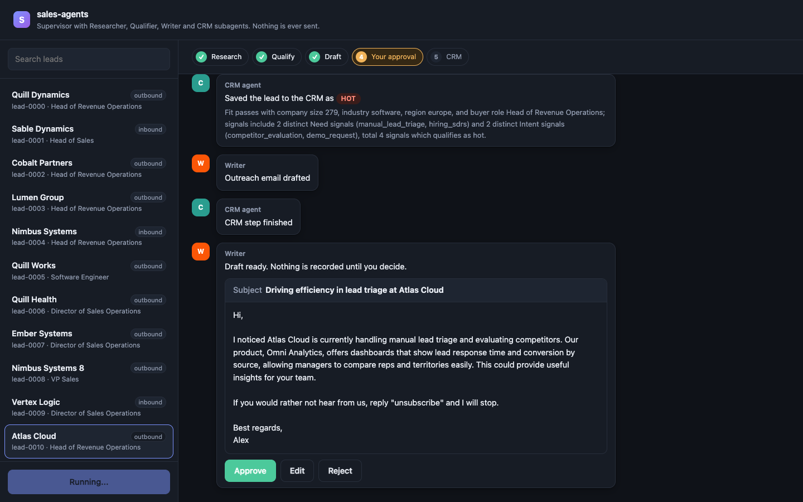

# Sales Agents: a supervised agent team for B2B lead qualification and outreach

A Supervisor built on [LangChain Deep Agents](https://github.com/langchain-ai/deepagents) hands each lead to four subagents (Researcher, Qualifier, Writer, CRM agent). A guardrail checks every draft and nothing is recorded until a human approves it. Synthetic data only, measured against gold labels. It sends no email and touches no real lead.


[Interactive diagram](docs/architecture.html) (download and open in a browser). A subagent gets only a lead id and reads the lead from a shared `LeadDesk`. The approval gate and the guardrail are code in front of the CRM write, not prompts.

## Use cases

1. [Lead qualification](docs/diagrams/1-qualification.png): hot, warm or cold with a reason.
2. [Outbound outreach](docs/diagrams/2-outbound-outreach.png): a grounded draft for a hot lead, approval, guardrail, CRM.
3. [Reply handling](docs/diagrams/3-reply-handling.png): classify a reply, update the CRM, draft a response.
4. [Inbound routing](docs/diagrams/4-inbound-routing.png): qualify a form request and route it to a rep.
5. [Lead reactivation](docs/diagrams/5-reactivation.png): pick quiet leads worth another touch.
6. [RFP bid or no-bid](docs/diagrams/6-rfp-bid-or-no-bid.png): a recommendation only.

Cases 1 and 2 run through the Supervisor. Cases 3 to 6 are pipeline functions, measured on their own and not wired to it yet.

## Demo page



Pick a lead, watch the subagents work, then approve, edit or reject the draft. More screenshots in [docs/screenshots](docs/screenshots).

## Telegram

The same approval flow in a chat, for the sales rep: pick a lead, watch the steps, then approve, edit or reject the draft. Set `SALES_AGENTS_TELEGRAM_BOT_TOKEN` and `SALES_AGENTS_TELEGRAM_ALLOWED_CHATS` (comma-separated chat ids). The bot answers only private chats on that list and refuses to start without it. A paused run lives in memory and is lost on restart. Slack, Teams, Zalo, email, a real CRM and WhatsApp are not built.

## Getting started

Python 3.11+ and [uv](https://docs.astral.sh/uv/).

```bash
uv sync
cp .env.example .env                                        # set OPENAI_API_KEY
uv run pytest                                               # offline, no tokens
uv run python -m sales_agents web                           # demo page at http://127.0.0.1:8000
uv run python -m sales_agents telegram                      # Telegram bot, needs the two variables above
uv run python -m sales_agents outbound lead-0010            # terminal, you approve the draft
uv run python -m sales_agents.eval.report                   # the results table
```

More detail: [docs/design.md](docs/design.md).

## Results

One run on 2026-11-13 with `openai:gpt-4.1-mini` ([results/measurements.json](results/measurements.json)).

| Use case | Agent | n | Metrics | Tokens |
|---|---|---|---|---|
| Lead qualification | Rule baseline | 60 | precision (hot) 1.000, recall (hot) 1.000 | 0 |
| Lead qualification | Qualifier (LLM) | 60 | precision (hot) 0.800, recall (hot) 1.000 | 26,982 |
| Researcher | Qualifier + Researcher | 60 | precision (hot) 1.000, recall (hot) 1.000 | 28,252 |
| Supervisor | Supervisor (subagents) | 30 | precision (hot) 0.909, recall (hot) 1.000 | 446,394 |
| Outbound outreach | Writer + guardrail + approver | 20 | guardrail pass rate 0.700 | 9,742 |
| Outbound outreach | Outbound path | 12 | CRM holds exactly the approved drafts 1.000 | 339,809 |
| Reply handling | Reply handling | 40 | classification accuracy 1.000 | 25,143 |
| Inbound routing | Inbound routing | 24 | correct-rep rate 1.000 | 11,274 |
| Lead reactivation | Selector (LLM) vs baseline | 40 | precision 1.000 vs 0.429 | 6,128 |
| RFP bid or no-bid | RFP bid or no-bid | 40 | accuracy 1.000 | 33,062 |

- The 1.000 rows are not a quality claim: gold labels and text come from the same templates as the prompts, and each number is one run.
- Through the Supervisor costs about 31 times the tokens and 5.4 times the time of calling the Qualifier directly, for hot precision 0.909 against 1.000.
- The guardrail over-blocks: 14 of 20 real model drafts passed.
- Not measured: real data, agreement with a human reviewer, Langfuse, other models. Caveats are in [docs/design.md](docs/design.md).
