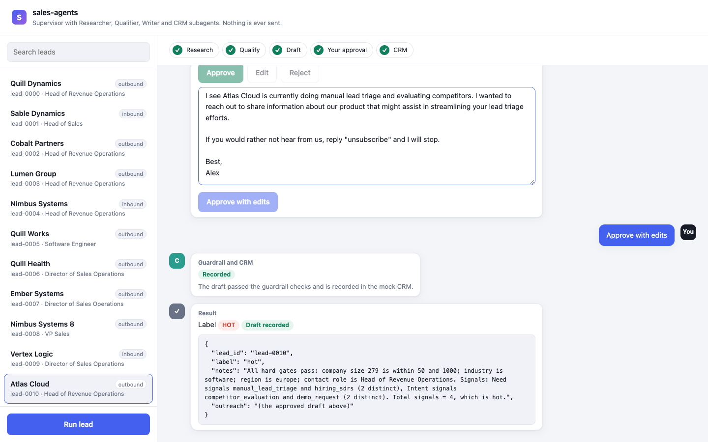

# Sales Agents: a supervised agent team for B2B lead qualification and outreach

A Supervisor built on [LangChain Deep Agents](https://github.com/langchain-ai/deepagents) hands each lead to four subagents, a Researcher, Qualifier, Writer and CRM agent. A guardrail checks every draft, and nothing is recorded until a human approves it. Everything runs on synthetic data for one fictional B2B SaaS seller and is measured against gold labels. This is a portfolio project: it sends no email and touches no real lead.


[Interactive version](docs/architecture.html) (download it and open it in a browser). Source: [docs/architecture.workflow.json](docs/architecture.workflow.json).

The Supervisor delegates and gets each result back, so the subagents never call each other. A subagent is given only a lead id and reads the lead through a shared `LeadDesk`, so the lead's free text never passes through the Supervisor's words. `record_outreach` pauses for a human decision, then the guardrail checks the approved text, and only then does the mock CRM (FastAPI over MCP) record it. These rules are in code, not in prompts.

## Use cases

Each has a diagram (PNG, plus an interactive HTML next to it).

1. **Lead qualification:** hot, warm or cold with a reason. [Diagram](docs/diagrams/1-qualification.png)
2. **Outbound outreach:** a grounded first message for a hot lead, approval, guardrail, CRM. [Diagram](docs/diagrams/2-outbound-outreach.png)
3. **Reply handling:** classify a reply, update the CRM, draft a response. [Diagram](docs/diagrams/3-reply-handling.png)
4. **Inbound routing:** qualify a form request and route it to a rep. [Diagram](docs/diagrams/4-inbound-routing.png)
5. **Lead reactivation:** pick quiet leads worth another touch. [Diagram](docs/diagrams/5-reactivation.png)
6. **RFP bid or no-bid:** a recommendation only. [Diagram](docs/diagrams/6-rfp-bid-or-no-bid.png)

Use cases 1 and 2 run through the Supervisor. Cases 3 to 6 are typed pipeline functions, measured on their own and not wired to the Supervisor yet, so their diagrams show the target design.

## Results

One run on 2026-11-13 with `openai:gpt-4.1-mini`, recorded in [results/measurements.json](results/measurements.json).

| Use case | Agent | n | Metrics | Tokens |
|---|---|---|---|---|
| Lead qualification | Rule baseline | 60 | precision (hot) 1.000, recall (hot) 1.000 | 0 |
| Lead qualification | Qualifier (LLM) | 60 | precision (hot) 0.800, recall (hot) 1.000 | 26,982 |
| Researcher | Qualifier + Researcher | 60 | precision (hot) 1.000, recall (hot) 1.000 | 28,252 |
| Supervisor | Supervisor (subagents) | 30 | precision (hot) 0.909, recall (hot) 1.000 | 446,394 |
| Outbound outreach | Writer + guardrail + approver | 20 | guardrail pass rate 0.700 | 9,742 |
| Outbound outreach | Outbound path | 12 | CRM holds exactly the approved drafts 1.000, label accuracy 1.000 | 339,809 |
| Reply handling | Reply handling | 40 | classification accuracy 1.000 | 25,143 |
| Inbound routing | Inbound routing | 24 | correct-rep rate 1.000 | 11,274 |
| Lead reactivation | Selector (LLM) vs baseline | 40 | precision 1.000 vs 0.429 | 6,128 |
| RFP bid or no-bid | RFP bid or no-bid | 40 | accuracy 1.000 | 33,062 |

- **The 1.000 rows are not a quality claim.** The gold labels and the text come from the same templates as the agents' prompts, so the sets are easy and the scores optimistic. Each number is one run.
- **Enrichment helps:** hot precision 0.800 to 1.000 for about 1,300 more tokens.
- **Subagents cost more:** on the same 30 leads, about 31 times the tokens and 5.4 times the time of calling the Qualifier directly, for hot precision 0.909 against 1.000.
- **The first Supervisor design lost accuracy because of context** (hot precision 0.650): task descriptions written by the Supervisor dropped the lead's facts. Passing only a lead id fixed it. That run is not recorded in `results/`.
- **The guardrail over-blocks:** 14 of 20 real model drafts passed, mostly paraphrased claims and numbers the check flagged.

Not measured: real data, agreement between the scripted approver and a human (the [hand-review sample](datasets/hand_review_sample.jsonl) is unlabelled), a Langfuse trace, other models, many seeds. Details and caveats for all of this are in [docs/design.md](docs/design.md).

## Demo page

`uv run python -m sales_agents web` serves a chat page: pick a lead, watch the subagents work, then approve, edit or reject the draft in the browser. Screenshots are from a real run.




## Getting started

Requires Python 3.11 or newer and [uv](https://docs.astral.sh/uv/).

```bash
uv sync
cp .env.example .env          # then set OPENAI_API_KEY

uv run pytest                                               # offline, no tokens
uv run python -m sales_agents web                           # demo page at http://127.0.0.1:8000
uv run python -m sales_agents outbound lead-0010            # terminal: you approve the draft
uv run python -m sales_agents outbound lead-0010 --scripted # the checklist approves instead
uv run python -m sales_agents.eval.report                   # the results table
uv run pytest -m llm -s tests/agents                        # measure again, costs about 1,000,000 tokens
```

Live tests estimate their tokens first and refuse to run above 1,000,000. Nothing is ever sent, and the mock CRM state is in `crm.sqlite3`.

## More

- [docs/design.md](docs/design.md): status, full results and caveats, design rules, each agent, the evaluation sets.
- Code is under `src/sales_agents/` (`agents/`, `tools/`, `crm_mock/`, `eval/`), seeded data in `datasets/`, tests in `tests/`.
