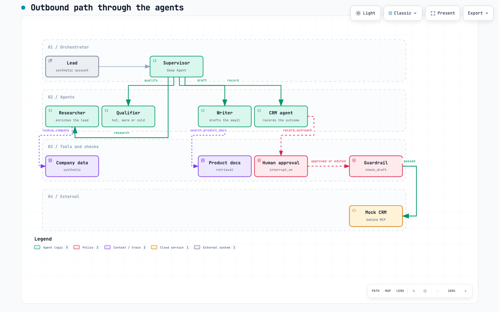

# sales-agents

A multi-agent sales system for one fictional B2B SaaS seller. It researches leads, qualifies them, drafts outreach, and records the outcome in a CRM. A guardrail checks every draft, and nothing counts as sent without a human approving it. Everything runs on synthetic data and is measured against gold labels.

This is a portfolio project. It does not send email, touch real leads or use real client data.

## Status

| Part | State |
|---|---|
| Schemas, qualification rubric, seeded lead generator | Done |
| Eval harness, token guard, rule baseline | Done |
| Qualifier | Done, first measurement below |
| Researcher, Supervisor, Writer, Guardrail, approver, CRM agent, mock CRM | Planned |
| Reply handling, inbound routing, reactivation, RFP bid or no-bid | Planned |

First measurement of the Qualifier on 60 synthetic leads with `openai:gpt-4.1-mini`, no enrichment:

| Agent | Precision (hot) | Recall (hot) | Tokens | p50 per lead |
|---|---|---|---|---|
| Rule baseline | 1.000 | 1.000 | 0 | under 1 ms |
| Qualifier (LLM) | 0.800 | 1.000 | 26,934 | 0.91 s |

Read these numbers with care. The gold labels come from the same rubric the Qualifier is told to apply, so the baseline is a ceiling and the LLM score is optimistic. The set is small and the text is written from a template. This is a first row, not a quality claim.

## What it does

The hero use case is lead qualification. The other use cases reuse the same agents. Each one has its own diagram, as a PNG with an interactive HTML version next to it (download the HTML and open it in a browser).

1. **Lead qualification:** decide which leads deserve a rep's time, as hot, warm or cold with a reason. [Diagram](docs/diagrams/1-qualification.png), [interactive](docs/diagrams/1-qualification.html).
2. **Outbound outreach:** draft a grounded first message for a qualified lead, check it, get approval, record it. [Diagram](docs/diagrams/2-outbound-outreach.png), [interactive](docs/diagrams/2-outbound-outreach.html).
3. **Reply handling:** classify a prospect's reply, draft a response, record the update. [Diagram](docs/diagrams/3-reply-handling.png), [interactive](docs/diagrams/3-reply-handling.html).
4. **Inbound routing:** qualify a form or demo request and route it to a rep. [Diagram](docs/diagrams/4-inbound-routing.png), [interactive](docs/diagrams/4-inbound-routing.html).
5. **Lead reactivation:** pick stale leads worth another touch and draft a message. [Diagram](docs/diagrams/5-reactivation.png), [interactive](docs/diagrams/5-reactivation.html).
6. **RFP bid or no-bid:** a recommendation on whether to respond to an RFP, decision only. [Diagram](docs/diagrams/6-rfp-bid-or-no-bid.png), [interactive](docs/diagrams/6-rfp-bid-or-no-bid.html).

The diagram sources are the `*.workflow.json` files next to them. Only the Qualifier exists today, so these diagrams show the planned flows.

## Architecture



[Open the interactive diagram](docs/architecture.html) (download it and open it in a browser). It supports pan, zoom, search and light or dark theme. The source is [docs/architecture.workflow.json](docs/architecture.workflow.json).

The diagram shows the outbound path. The Supervisor decides the order and calls the other agents, so the straight line is the common case, not a fixed pipeline.

Design rules:

- **Agents are plain typed functions.** Each takes a typed input and returns a typed output, so it can be evaluated alone against gold labels.
- **The Supervisor is the Deep Agent.** It is built with `create_deep_agent` from [LangChain Deep Agents](https://github.com/langchain-ai/deepagents) and wires the others in as subagents or tools. Deep Agents runs on LangGraph, which supplies streaming, checkpointing and human-in-the-loop.
- **Safety rules live in code, not in prompts.** The guardrail and the approval gate run inside tool code. A rejected draft never reaches the CRM as approved, and an edited draft records the edited text.
- **Measure before wiring.** Each agent gets a number on its own before the Supervisor connects it.

## Agents

### Supervisor

Receives a lead and decides which agents to call and in what order. It is a Deep Agent, so it has planning and delegation built in. It owns no business rules. Planned.

### Researcher

Enriches a lead with company facts: size, industry, region and public signals. The data is synthetic. Its value is the change in Qualifier accuracy with and without enrichment, so it is measured against the Qualifier baseline. Planned.

### Qualifier

Takes a `Lead` and an optional `CompanyRecord` and returns a `QualificationResult` with a label (hot, warm or cold) and a short reason. It makes one structured-output model call and uses no tools. The prompt is built from the rubric constants, and the lead's free-text notes are wrapped in a delimited block that the prompt marks as untrusted data. Implemented in [src/sales_agents/agents/qualifier.py](src/sales_agents/agents/qualifier.py).

The rubric:

- **Fit gate:** company size 50 to 1000, a target industry, a target region.
- **Buyer role gate:** the contact holds a buyer role such as VP Sales or Head of Revenue Operations.
- **Need and Intent:** scored from signals, at most 2 points each. A total of 3 or more is hot, 1 or 2 is warm, 0 is cold.
- **Missing data:** a missing gate field makes the lead cold, with the missing field named in the reason.

The thresholds are the builder's choices, set in [src/sales_agents/rubric.py](src/sales_agents/rubric.py).

### Writer

Drafts a first outreach message for a qualified lead, grounded in the fictional product docs through retrieval. Planned.

### Guardrail

Checks each draft for claims the product docs do not support, prohibited content and a missing opt-out. It runs inside tool code. Planned.

### Human approval

Nothing counts as sent until a human approves, even when the guardrail passes. In evals the approver is a scripted checklist: no claim outside the product docs, opt-out present, tone and length within bounds. A small hand-reviewed sample checks that the checklist matches human judgment. There is no LLM judge for headline numbers. Planned.

### CRM agent

Records the approved outcome in a mock CRM through an MCP server. Running the same lead twice updates its record instead of creating a duplicate. Planned.

## Evaluation

- **Headline metric:** precision and recall of the hot label, plus the 3x3 confusion matrix (hot, warm, cold), plus cost and latency per lead.
- **Failures count as wrong.** A timeout or invalid output is a wrong prediction and stays in the denominator.
- **Token guard.** The harness estimates tokens before a run and refuses to start when the estimate is above the cap. The cap is 2,000,000 tokens per run, set in [src/sales_agents/config.py](src/sales_agents/config.py).
- **Synthetic data.** A seeded script samples lead attributes, then derives the gold label from the rubric. About 20% of cases are ambiguous (near a threshold or just outside the size gate), and some leads miss a gate field.
- **Known limit.** Labels and the Qualifier share one rubric, so accuracy can look better than it would on real data.

## Getting started

Requires Python 3.11 or newer and [uv](https://docs.astral.sh/uv/).

```bash
uv sync
cp .env.example .env          # then set OPENAI_API_KEY

uv run pytest                                  # offline, no tokens
uv run python -m sales_agents.datagen          # regenerate datasets/leads_seed42.jsonl
uv run python -m sales_agents.eval.harness     # results table for the rule baseline
```

To measure the real Qualifier, which calls the model (about 27,000 tokens for the 60-lead set):

```bash
uv run pytest -m llm -s tests/agents/test_qualifier_llm.py
```

Tests that call a real model carry the `llm` marker and are excluded from the default run.

## Layout

```
src/sales_agents/
  config.py        settings from the environment
  schemas.py       Lead, CompanyRecord, QualificationResult, LabelledLead
  rubric.py        deterministic labeller
  datagen.py       seeded synthetic lead generator
  agents/          qualifier.py, baseline.py
  eval/            metrics.py, harness.py, tokens.py
datasets/          committed gold set, fixed seed
docs/              architecture diagram
tests/             offline tests, plus llm-marked tests
```
