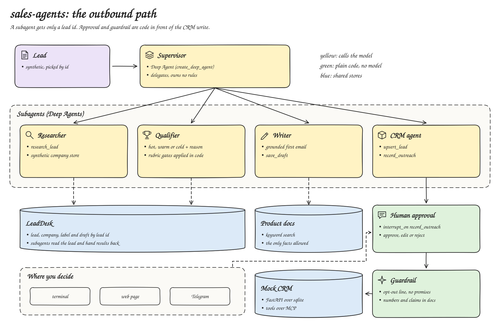
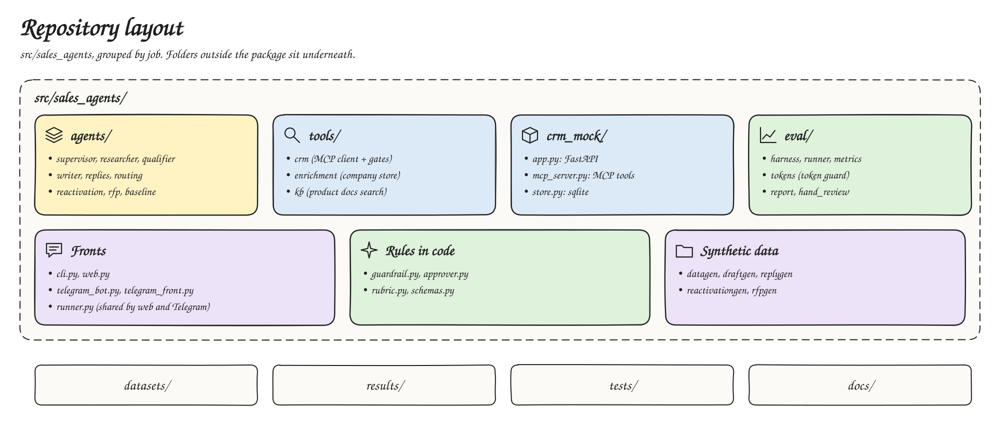
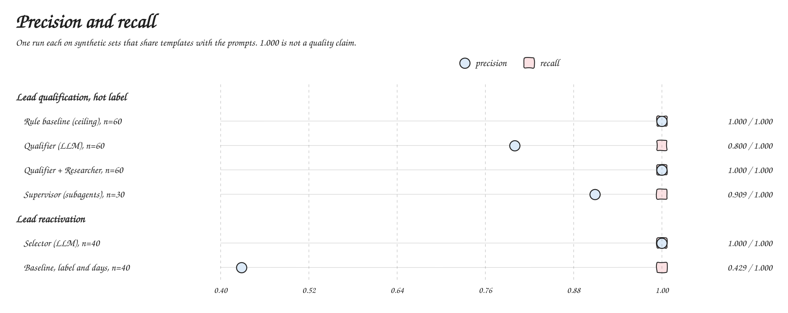
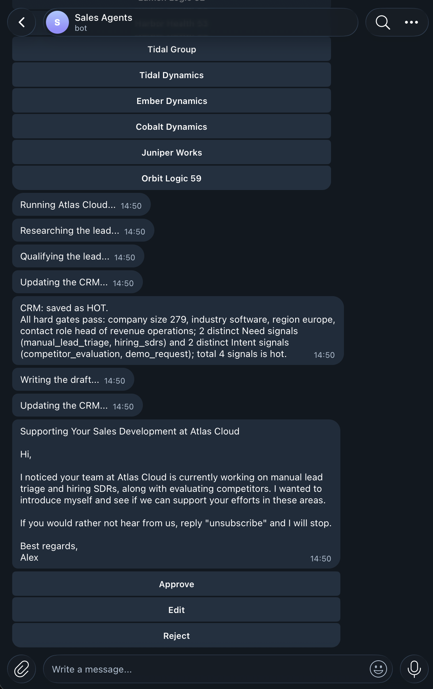

<div align="center">

# Sales Agents

**A supervised agent team for B2B lead qualification and outreach, measured on synthetic data against gold labels.**


[Architecture](#architecture) · [Results](#results) · [Use cases](#use-cases) · [Quickstart](#quickstart) · [Demo page and Telegram](#demo-page-and-telegram) · [Design details](docs/design.md)

</div>

A Supervisor built on [LangChain Deep Agents](https://github.com/langchain-ai/deepagents) hands each lead to four subagents (Researcher, Qualifier, Writer, CRM agent). A guardrail checks every draft and nothing is recorded until a human approves it. Synthetic data only, measured against gold labels. It sends no email and touches no real lead.

| At a glance | |
|---|---|
| Use cases | 6 (2 through the Supervisor, 4 as pipeline functions) |
| Subagents under the Supervisor | 4: Researcher, Qualifier, Writer, CRM agent |
| Synthetic evaluation sets | 6, seeded, with gold labels ([details](docs/design.md#evaluation)) |
| Places a human approves a draft | 3: terminal, web page, Telegram |

## Architecture

<p align="center"></p>

A subagent gets only a lead id and reads the lead from a shared `LeadDesk`. The approval gate and the guardrail are code in front of the CRM write, not prompts. The original [interactive diagram](docs/architecture.html) (download and open in a browser) is kept alongside.

<p align="center"></p>

<details>
<summary>Tech stack</summary>

| Part | Used for |
|---|---|
| [LangChain Deep Agents](https://github.com/langchain-ai/deepagents) 0.7.37 | The Supervisor and its subagents (`create_deep_agent`), on LangGraph for checkpointing and human-in-the-loop |
| `langchain[openai]` | The model, `openai:gpt-4.1-mini` by default (`SALES_AGENTS_MODEL`) |
| `mcp`, `langchain-mcp-adapters` | The mock CRM's tools (`upsert_lead`, `record_outreach`, `list_records`) |
| FastAPI, uvicorn, sqlite | The demo page and the mock CRM |
| `python-telegram-bot` | The Telegram front |
| Langfuse | Optional tracing extra (`uv sync --extra tracing`), never checked against a Langfuse server |
| pytest | Offline tests, live tests marked `llm` |

</details>

## Results

<p align="center"></p>

One run on 2026-11-13 with `openai:gpt-4.1-mini` ([results/measurements.json](results/measurements.json)). The chart is drawn from that file.

| Use case | Agent | n | Metrics | Tokens |
|---|---|---|---|---|
| Lead qualification | Rule baseline | 60 | precision (hot) 1.000, recall (hot) 1.000 | 0 |
| Lead qualification | Qualifier (LLM) | 60 | precision (hot) 0.800, recall (hot) 1.000 | 26,982 |
| Researcher | Qualifier + Researcher | 60 | precision (hot) 1.000, recall (hot) 1.000 | 28,252 |
| Supervisor | Supervisor (subagents) | 30 | precision (hot) 0.909, recall (hot) 1.000 | 446,394 |
| Outbound outreach | Writer + guardrail + approver | 20 | guardrail pass rate 0.700 | 9,742 |
| Outbound outreach | Outbound path | 12 | CRM holds exactly the approved drafts 1.000 | 339,809 |
| Reply handling | Reply handling | 40 | classification accuracy 1.000 | 25,143 |
| Inbound routing | Inbound routing | 24 | correct-rep rate 1.000 | 11,274 |
| Lead reactivation | Selector (LLM) vs baseline | 40 | precision 1.000 vs 0.429 | 6,128 |
| RFP bid or no-bid | RFP bid or no-bid | 40 | accuracy 1.000 | 33,062 |

- The 1.000 rows are not a quality claim: gold labels and text come from the same templates as the prompts, and each number is one run.
- Through the Supervisor costs about 31 times the tokens and 5.4 times the time of calling the Qualifier directly, for hot precision 0.909 against 1.000.
- The guardrail over-blocks: 14 of 20 real model drafts passed.
- Not measured: real data, agreement with a human reviewer, Langfuse, other models. Caveats are in [docs/design.md](docs/design.md).

## Use cases

| Area | Use case | What it does | Code |
|---|---|---|---|
| Through the Supervisor | [1. Lead qualification](docs/diagrams/1-qualification.png) | Hot, warm or cold with a reason | [qualifier.py](src/sales_agents/agents/qualifier.py) |
| Through the Supervisor | [2. Outbound outreach](docs/diagrams/2-outbound-outreach.png) | A grounded draft for a hot lead, approval, guardrail, CRM | [supervisor.py](src/sales_agents/agents/supervisor.py) |
| Pipeline function | [3. Reply handling](docs/diagrams/3-reply-handling.png) | Classify a reply, update the CRM, draft a response | [replies.py](src/sales_agents/agents/replies.py) |
| Pipeline function | [4. Inbound routing](docs/diagrams/4-inbound-routing.png) | Qualify a form request and route it to a rep | [routing.py](src/sales_agents/agents/routing.py) |
| Pipeline function | [5. Lead reactivation](docs/diagrams/5-reactivation.png) | Pick quiet leads worth another touch | [reactivation.py](src/sales_agents/agents/reactivation.py) |
| Pipeline function | [6. RFP bid or no-bid](docs/diagrams/6-rfp-bid-or-no-bid.png) | A recommendation only | [rfp.py](src/sales_agents/agents/rfp.py) |

Cases 1 and 2 run through the Supervisor. Cases 3 to 6 are pipeline functions, measured on their own and not wired to it yet.

## Quickstart

Python 3.11+ and [uv](https://docs.astral.sh/uv/).

```bash
uv sync && cp .env.example .env              # set OPENAI_API_KEY in .env
uv run pytest                                # offline, no tokens
uv run python -m sales_agents web            # demo page at http://127.0.0.1:8000
```

<details>
<summary>More commands</summary>

```bash
uv run python -m sales_agents outbound lead-0010            # terminal, you approve the draft
uv run python -m sales_agents outbound lead-0010 --scripted # answer with the eval checklist instead
uv run python -m sales_agents telegram                      # Telegram bot, needs the two variables below
uv run python -m sales_agents.eval.report                   # the results table
uv run python -m sales_agents.eval.outreach                 # guardrail on planted faults
uv run python -m sales_agents.eval.hand_review              # after filling the human field in the hand-review sample
```

`web`, `outbound` and `telegram` take `--crm-db` for the mock CRM's sqlite file (default `crm.sqlite3`), and `web` takes `--port`. More detail: [docs/design.md](docs/design.md).

</details>

## Demo page and Telegram


Pick a lead, watch the subagents work, then approve, edit or reject the draft. More screenshots in [docs/screenshots](docs/screenshots).



The same approval flow in a chat, for the sales rep: pick a lead, watch the steps, then approve, edit or reject the draft. Set `SALES_AGENTS_TELEGRAM_BOT_TOKEN` and `SALES_AGENTS_TELEGRAM_ALLOWED_CHATS` (comma-separated chat ids). The bot answers only private chats on that list and refuses to start without it. A paused run lives in memory and is lost on restart. The bot handles one update at a time, so a run in progress holds up every chat. Slack, Teams, Zalo, email, a real CRM and WhatsApp are not built.

## Adding an agent

1. Write its logic as a plain typed function in `src/sales_agents/agents/`, so it can be called and evaluated alone.
2. Measure it on its own against gold labels before wiring it in, and record the run in `results/measurements.json`.
3. Then give it to the Supervisor as a Deep Agents subagent with the same prompt, in [supervisor.py](src/sales_agents/agents/supervisor.py).

Keep safety rules in code, not in prompts. The design rules behind these steps are in [docs/design.md](docs/design.md#architecture).

To redraw the diagrams in this README after a change, edit and run the script. It reads the chart's numbers from `results/measurements.json`:

```bash
python docs/diagrams/make_diagrams.py
```

## Tests and status

`uv run pytest` runs offline and spends no tokens. Tests marked `llm` call a real model and run only through the token guard, which estimates a run's tokens first and refuses to start above the cap (2,000,000 by default, `SALES_AGENTS_EVAL_TOKEN_CAP`). What is done, measured or still code only is in the [status table](docs/design.md#status).

## Licenses

<details>
<summary>Data and third-party files</summary>

- **Data:** all data is synthetic and the CRM is a mock. No real lead, reply, RFP or CRM.
- **Diagram font:** [Patrick Hand](docs/diagrams/OFL.txt), SIL Open Font License 1.1, embedded in the SVGs in `docs/diagrams/`.

</details>

Code: the repository has no license file yet.
