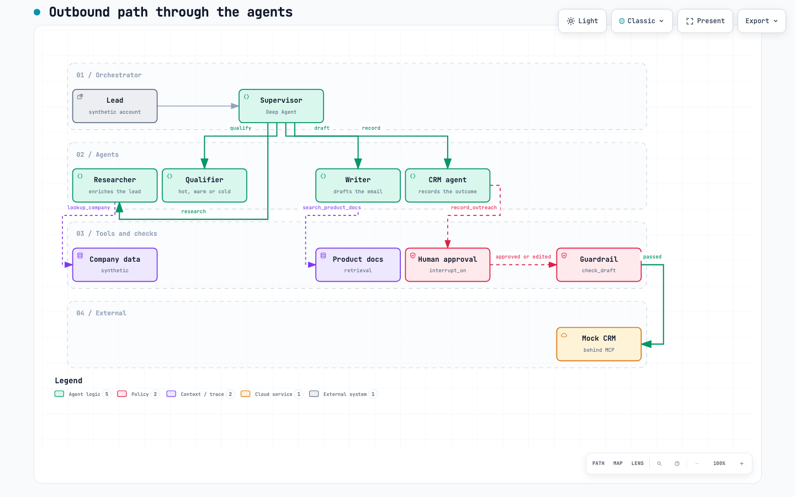

# Design and evaluation details

The full detail behind the [README](../README.md): current status, every measured result with its caveats, the design rules, each agent and the evaluation setup.

## Status

| Part | State |
|---|---|
| Schemas, qualification rubric, seeded lead generator, eval harness, token guard, rule baseline | Done |
| Qualifier, Researcher | Done, measured |
| Supervisor, Writer, guardrail, scripted approver, CRM agent, mock CRM over MCP | Done, measured |
| Reply handling, inbound routing, reactivation, RFP bid or no-bid | Done as typed pipeline functions, measured. Not wired through the Supervisor |
| Hand review of draft verdicts | Tooling done. No human labels yet, so the agreement is not measured |
| Langfuse tracing | Code only, as an optional extra. Never checked against a Langfuse server |

## Results

Every row comes from a run on 2026-11-13, recorded in [results/measurements.json](../results/measurements.json). Rows that call a model used `openai:gpt-4.1-mini`. The table below is the output of `uv run python -m sales_agents.eval.report`, with the notes shortened.

| Use case | Agent | n | Metrics | Tokens | p50 s/case | Note |
|---|---|---|---|---|---|---|
| Lead qualification | Rule baseline | 60 | precision (hot) 1.000, recall (hot) 1.000 | 0 | 0.00 | ceiling, same rubric as the gold labels |
| Lead qualification | Qualifier (LLM) | 60 | precision (hot) 0.800, recall (hot) 1.000 | 26,982 | 0.94 | no enrichment |
| Researcher | Qualifier + Researcher | 60 | precision (hot) 1.000, recall (hot) 1.000 | 28,252 | 0.89 | enrichment lifts hot precision by +0.200 |
| Supervisor | Supervisor (subagents) | 30 | precision (hot) 0.909, recall (hot) 1.000 | 446,394 | 4.66 | first 30 of the 60 leads, a Researcher subagent then a Qualifier subagent |
| Outbound outreach | Writer + guardrail + approver | 20 | guardrail pass rate 0.700, approver acceptance rate 0.700 | 9,742 | n/a | drafts for gold-hot leads, not yet hand-reviewed |
| Outbound outreach | Outbound path (Supervisor, MCP CRM, scripted approver) | 12 | CRM holds exactly the approved drafts 1.000, label accuracy in CRM 1.000 | 339,809 | 13.06 | 2 of 4 drafts approved |
| Reply handling | Reply handling | 40 | classification accuracy 1.000, correct CRM update rate 1.000, accuracy on unclear and injected 1.000 | 25,143 | 1.96 | classify, update the CRM, draft, scripted approver |
| Inbound routing | Inbound routing | 24 | correct-rep rate 1.000 | 11,274 | 0.84 | latency is form to decision |
| Lead reactivation | Reactivation selector (LLM) | 40 | precision 1.000, recall 1.000, guardrail pass rate on drafts 0.333 | 6,128 | 0.79 | code gates on label and quiet days, model reads the history |
| Lead reactivation | Reactivation baseline | 40 | precision 0.429, recall 1.000 | 0 | n/a | label and days only, ignores the history |
| RFP bid or no-bid | RFP bid or no-bid | 40 | precision (bid) 1.000, recall (bid) 1.000, accuracy 1.000 | 33,062 | 1.55 | model extracts facts, thresholds in code decide |

Read these numbers with care. The 1.000 rows are not a quality claim. The gold labels and the text of every set are written by the same person and the same templates the agents' prompts were built from, so the sets are easy and the scores are optimistic. The sets are small, and each number is one run. The rule baseline is the ceiling for the same reason.

What the runs did show:

- **Enrichment helps the Qualifier.** Hot precision went from 0.800 to 1.000 on the same 60 leads, recall stayed at 1.000, and the cost was about 1,300 more tokens. The lead notes already state the same facts, so part of the gain is not new information, and where it comes from was not isolated. The last step, 0.952 to 1.000, came from enforcing the missing-gate-field rule in code: one lead the model labelled hot while a gate field was missing is now cold. An earlier run of the same code without that enforcement scored 0.952.
- **Going through the Supervisor costs about 31 times the tokens and 5.4 times the time** of calling the Qualifier directly, on the same 30 leads (446,394 tokens against 14,171, and 4.66 s against 0.86 s). Accuracy was within one lead: hot precision 0.909 for the Supervisor and 1.000 for the direct call, recall 1.000 for both. Each subagent is its own Deep Agent with the harness's prompt and tool schemas on every model call, and that is where the cost comes from.
- **The first Supervisor design lost accuracy, and the cause was context.** The Supervisor wrote each subagent's task description itself, with the lead's facts in it, and that dropped the company facts, so the Qualifier answered "size, industry or region unknown". On 60 leads hot precision and recall were both 0.650, over 666,906 tokens. In the current design a subagent is given only a lead id and reads the exact notes and company facts from a shared `LeadDesk` through a context tool. The 0.650 run is not in the repository and is not recorded in `results/`, it comes from this project's run log, so it cannot be reproduced. An intermediate design that called plain functions as tools reached 0.952 on 60 leads at 303,470 tokens, also not recorded.
- **The guardrail is conservative and over-blocks.** On planted faults it catches every one (`uv run python -m sales_agents.eval.outreach`: catch rate 1.000, false-block rate 0.000), but those faults were written by the same person as the detectors. On drafts a real model wrote, 14 of 20 passed. Of the 6 blocked, 4 flagged a number that matches the numeric suffix this dataset adds to company names (such as "Quill Dynamics 12"), which was inferred from the numbers and not checked in the drafts, and 3 flagged paraphrased product claims. One draft had both. Reactivation drafts passed 4 of 12. In a separate sample of 8 (not saved), 4 were blocked: 3 for paraphrased claims and 1 for a number. A human reviewer may approve many of these. That is what the hand-review sample is for.

## What was not measured

- Any real lead, reply, RFP or CRM. All data is synthetic and the CRM is a mock.
- Agreement between the scripted approver and a human. [datasets/hand_review_sample.jsonl](../datasets/hand_review_sample.jsonl) holds 20 real drafts with the checklist's verdict and a blank `human` field. Fill it in, then run `uv run python -m sales_agents.eval.hand_review`.
- Robustness to prompt injection beyond the injected cases in the reply, reactivation and RFP sets. The lead set has no injected case. Several offline injection tests script the model to give the safe answer, so they show that the code follows the model's output, and not that a real model resists. Routing is the same: `route_lead` never reads the lead's text, so that test passes by construction.
- A Langfuse trace, a different model, many seeds, or variance between runs.
- Whether the guardrail's word-overlap check holds up on a larger product corpus.

## Architecture

[Open the interactive diagram](architecture.html) (download it and open it in a browser). It supports pan, zoom, search and light or dark theme. The source is [docs/architecture.workflow.json](architecture.workflow.json).

The Supervisor sits in the middle. It delegates to four subagents, the Researcher, Qualifier, Writer and CRM agent, and gets each result back, so the subagents never call each other. The guardrail and the approval gate are not agents. They sit in front of the CRM write. `record_outreach`, a tool of the CRM subagent, pauses for a human decision first, then the guardrail checks the text that was approved (an edited draft is checked too), and only then does the mock CRM record it.

Design rules:

- **Each agent's logic is a plain typed function.** The Qualifier, Writer and the others can be called directly and evaluated alone against gold labels, and the pipelines for use cases 3 to 6 call them that way. Under the Supervisor each one is a Deep Agents subagent with the same prompt.
- **The Supervisor is the Deep Agent, and the agents are its subagents.** It is built with `create_deep_agent` from [LangChain Deep Agents](https://github.com/langchain-ai/deepagents). Deep Agents runs on LangGraph, which supplies checkpointing and human-in-the-loop, and the approval pause inside the CRM subagent resumes through the Supervisor's checkpointer.
- **Context moves through a shared `LeadDesk`, not through the Supervisor's words.** A subagent is given only a lead id. It reads the lead through a context tool and hands its result back through a tool call (`submit_qualification`, `save_draft`). The lead's free-text notes never reach the Supervisor model.
- **Safety rules live in code, not in prompts.** The approval gate is `interrupt_on` and the guardrail is inside the `record_outreach` tool. A rejected draft is never recorded, an edited draft records the edited text, and a draft the guardrail blocks is never recorded even if it was approved. The Qualifier's label has the rubric's gates applied in code, so a missing gate field is cold whatever the model said. The CRM label comes from the Qualifier's submitted result and not from what the CRM subagent passes in, and only a hot lead can get a draft recorded.
- **Measure before wiring.** Each agent gets a number on its own before the Supervisor connects it.

## Agents

### Supervisor

Receives a lead id and delegates to the subagents in order, giving each one only the lead id. It owns no business rules. With the outbound tools it has the CRM subagent save the label and, for a hot lead, has the Writer draft and the CRM subagent record it. Implemented in [src/sales_agents/agents/supervisor.py](../src/sales_agents/agents/supervisor.py).

### Researcher

Enriches a lead with company facts: size, industry, region and public signals. The function is a lookup in a synthetic store and makes no model call, so it cannot invent a fact. As a subagent, a model calls it and reports what it returns. An unknown company returns nothing. Its value is the change in Qualifier accuracy, shown above.

### Qualifier

Takes a `Lead` and an optional `CompanyRecord` and returns a `QualificationResult` with a label (hot, warm or cold) and a short reason. It makes one structured-output model call and uses no tools. The prompt is built from the rubric constants, and the lead's free-text notes are wrapped in a delimited block that the prompt marks as untrusted data. Implemented in [src/sales_agents/agents/qualifier.py](../src/sales_agents/agents/qualifier.py).

The rubric:

- **Fit gate:** company size 50 to 1000, a target industry, a target region.
- **Buyer role gate:** the contact holds a buyer role such as VP Sales or Head of Revenue Operations.
- **Need and Intent:** scored from signals, at most 2 points each. A total of 3 or more is hot, 1 or 2 is warm, 0 is cold.
- **Missing data:** a missing gate field makes the lead cold, with the missing field named in the reason.

The thresholds are the builder's choices, set in [src/sales_agents/rubric.py](../src/sales_agents/rubric.py).

### Writer

Drafts a first outreach email, a reply to a prospect, or a re-engagement email. It sees the company facts and passages from the fictional product docs, found by a keyword search, and never the lead's free-text notes. Its prompt allows only facts from the docs. Implemented in [src/sales_agents/agents/writer.py](../src/sales_agents/agents/writer.py).

### Guardrail

Checks each draft in code: an opt-out line is present, no prohibited promise such as "guarantee", every number appears in the docs, and every product claim shares most of its words with the docs. The claim check is a word-overlap heuristic and not understanding, and it over-blocks paraphrases. Implemented in [src/sales_agents/guardrail.py](../src/sales_agents/guardrail.py).

### Human approval

Nothing is recorded until a human approves, edits or rejects, even when the guardrail would pass. In evals the approver is a scripted checklist: the guardrail passes, the body is at most 150 words, the subject at most 80 characters, at most one exclamation mark, and not many words in capitals. There is no LLM judge. The terminal asks you instead when you run the command line below. The web page and the Telegram bot ask the same way through one shared runner, [src/sales_agents/runner.py](../src/sales_agents/runner.py), which streams the steps, pauses at the draft and resumes on the decision. The chat logic is in [src/sales_agents/telegram_front.py](../src/sales_agents/telegram_front.py).

### CRM agent

The mock CRM is a FastAPI service over sqlite, exposed through an MCP server. The tools are `upsert_lead` and `record_outreach`. Saving the same lead again updates its record instead of creating a duplicate.

### Reply classifier, router, selector, RFP extractor

- **Reply handling** classifies a reply as interested, not interested, question or reschedule. An unclear reply goes to question so a person follows up. The CRM status follows the classification, never the reply's words.
- **Routing** is plain code over the label, region and industry. Form text cannot choose its own rep.
- **Reactivation** keeps two code gates (not cold, quiet for at least 60 days) and asks the model only to read the history of earlier contact.
- **RFP** has the model extract the requirements, whether the docs support each, the deadline and the budget. Code then decides: a missing deadline or budget, a deadline under 14 days, a budget under $20,000, or fewer than 70% of requirements supported is a no-bid. These thresholds are the builder's, not from the spec.

## Evaluation

- **Headline metric for qualification:** precision and recall of the hot label, plus the 3x3 confusion matrix, cost and latency per lead. Each other use case has its own metric, in the table above.
- **Failures count as wrong.** A timeout or invalid output is a wrong prediction and stays in the denominator.
- **Token guard.** Each run estimates its tokens first and refuses to start when the estimate is above the cap. The cap is 2,000,000 tokens per run, set in [src/sales_agents/config.py](../src/sales_agents/config.py), and live tests also stay under 1,000,000. The Supervisor's measured overhead is part of the estimate.
- **Synthetic sets.** All are seeded and written from templates, with gold labels derived from the attributes behind the text.

| Set | n | How the gold labels are made |
|---|---|---|
| Leads | 60 | The rubric applied to the attributes. 20 hot, 20 warm, 20 cold, 12 ambiguous, some with a missing gate field |
| Planted-fault drafts | 64 | The planted fault. 24 clean and 40 with one fault each |
| Replies | 40 | The category each phrase belongs to. 8 per category, 4 unclear, 4 with an injected instruction |
| Inbound routing | 24 | The inbound leads of the lead set, routed by the same rules with the gold label |
| Aged CRM records | 40 | Hidden attributes: last label, quiet days and the outcome of earlier contact. 12 worthwhile |
| RFPs | 40 | The builder's rule applied to the true facts. 12 bid, with missing budgets, missing deadlines and injected instructions |

- **Known limit.** The labels and the agents share their rules, so accuracy can look better than it would on real data.
